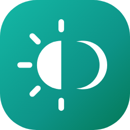
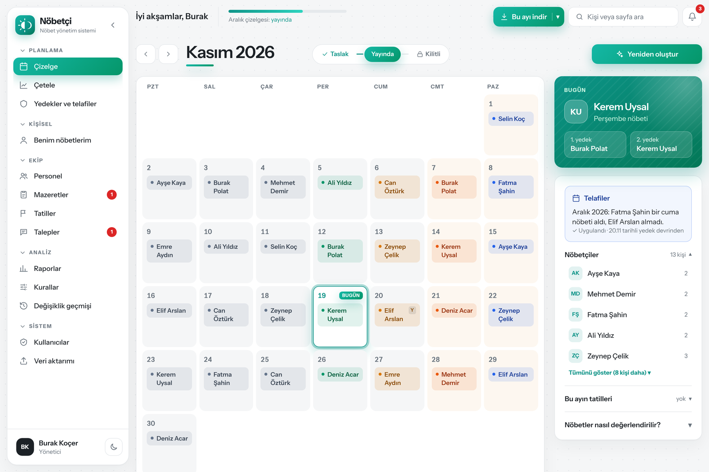
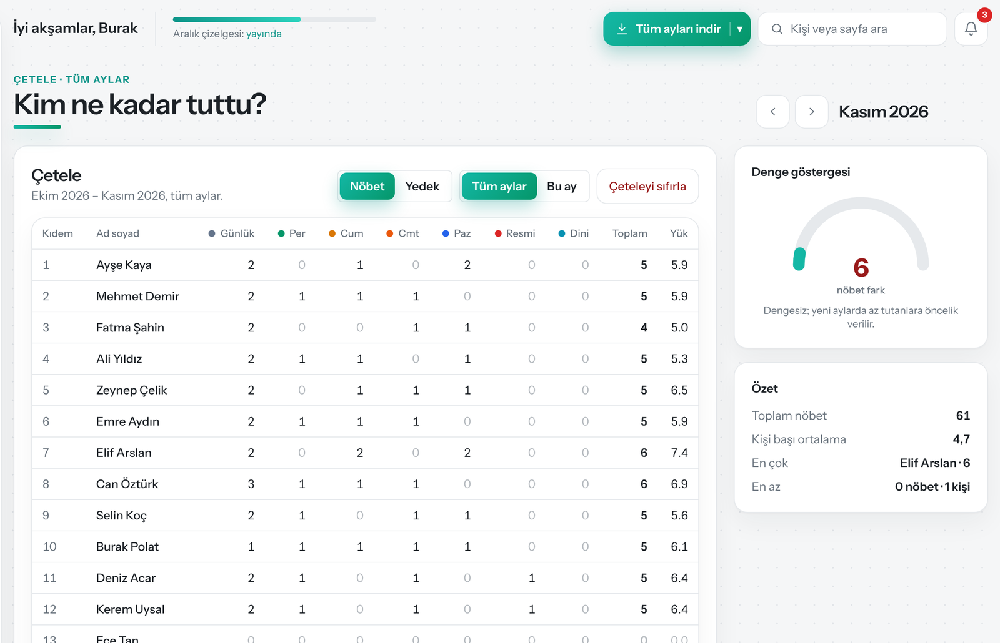
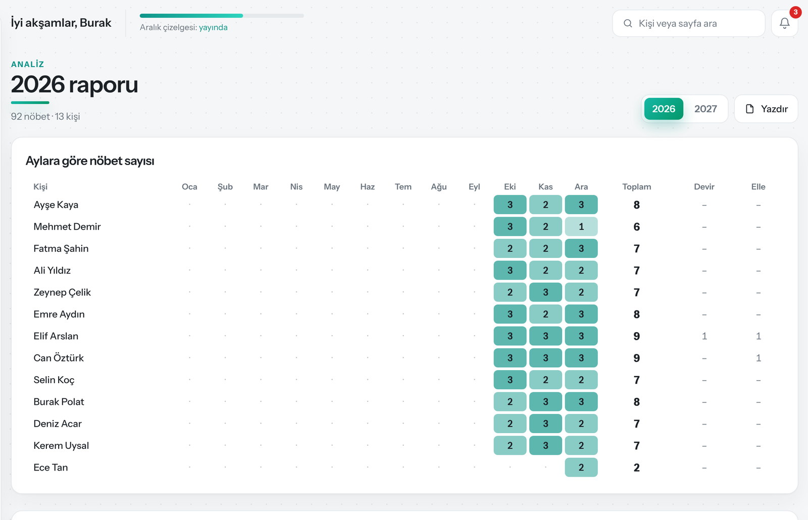
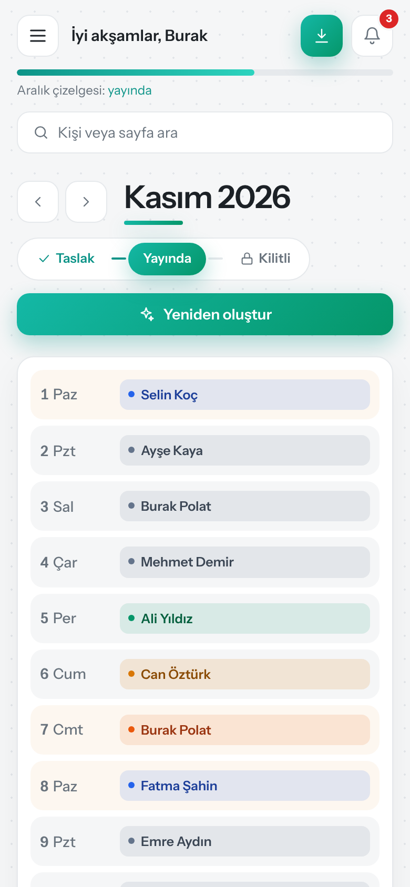

  

<h1 align="center">Nöbetçi</h1>

<b>Adil nöbet çizelgesi — kendi bilgisayarınızda, tek tıkla kurulum.</b>

  <a href="../../releases/latest"><b>⬇ Son sürümü indir (NobetciKurulum.exe)</b></a> 
  Windows 10 / 11 · 64 bit · yönetici izni gerekmez

## Neler yapar?

- **Adil çizelge:** Aylık nöbet çizelgesini; kıdem, mazeretler, tatiller ve geçmiş aylardaki yük dengesine göre kendisi yazar. Her nöbetin neden o kişiye verildiği açıklanır.
- **Mazeret ve tatil:** İzin, rapor, görev, sınav, kurs; resmi tatiller ve dini bayramlar (isteğe bağlı kura ile).
- **Çetele:** Kim hangi türden kaç nöbet tuttu; ay ay ya da toplam. Excel ve PDF olarak indirilir.
- **Yedekler ve telafiler:** Yedek nöbetçiler, nöbet devri, devralınan nöbetin bir sonraki ay telafisi.
- **Talepler:** Personel mazeret, nöbet değişimi ve devir talebinde bulunur; yönetici onaylar.
- **Yedekleme ve güncelleme:** Sistem → Bakım sayfasından tek tıkla yedek alma, yedekten geri dönme ve güncelleme.

| Çetele | Raporlar | Telefonda |
|---|---|---|
|  |  |  |

## Kurulum

1. [Son sürüm](../../releases/latest) sayfasından **NobetciKurulum.exe** dosyasını indirin.
2. Dosyaya çift tıklayın. Windows “Bilgisayarınız korundu” derse **Ek bilgi → Yine de çalıştır**'a basın.
3. **Kur**'a basın. Bir dakika içinde Nöbetçi tarayıcınızda açılır.
4. Açılan ekranda **yönetici hesabınızı** (ad, kullanıcı adı, parola) oluşturun.
5. Uygulama açılınca **Sistem → Lisans** sayfasından size verilen **.lisans** dosyasını yükleyin.
6. **Başlarken** kartındaki adımları izleyin: personeli ekleyin, kuralları gözden geçirin, ilk çizelgeyi oluşturun.

> Lisans girilene kadar menülerde gezebilir, her şeye bakabilirsiniz; ekleme ve değiştirme kapalıdır. Lisans için uygulamayı size veren kişiyle görüşün.

## Sık sorulanlar

**Verilerim nerede?** Yalnızca sizin bilgisayarınızda: `%LOCALAPPDATA%\Nobetci`. İnternete gönderilmez.

**Diğer bilgisayarlardan girilebilir mi?** Kurulumda “Ağdaki diğer bilgisayarlar da girebilsin” seçeneğini işaretleyin. Diğer bilgisayarlar `http://<bu-bilgisayarın-adı>:3000` adresinden girer. Windows Güvenlik Duvarı izin isterse onaylayın.

**Güncelleme nasıl yapılır?** Yeni sürüm çıkınca **Sistem → Bakım** sayfasında haber verilir; **Şimdi güncelle**'ye basmanız yeterli. Önce verileriniz kendiliğinden yedeklenir.

**Başka bilgisayara nasıl taşırım?** Bakım → **Taşıma dosyasını indir**. Yeni bilgisayarda Nöbetçi'yi kurun, yönetici hesabını oluşturun, Bakım → **Yedekten geri dön** ile dosyayı yükleyin.

**Kaldırırsam verilerim silinir mi?** Hayır. Yeniden kurduğunuzda kaldığınız yerden devam eder.

---

© Burak Koçer. Tüm hakları saklıdır. Bu depo yalnızca kurulum dosyalarını içerir.
